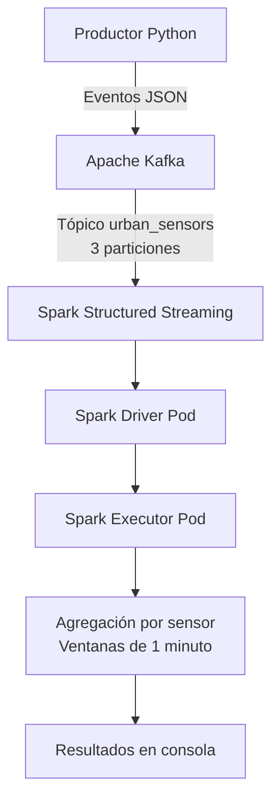

# Pre-entrega 3 — Plataforma de Muestreo Urbano en Tiempo Real

## Descripción

Este proyecto implementa una plataforma de procesamiento distribuido de datos en tiempo real utilizando Apache Kafka, Apache Spark y Kubernetes.

La solución utiliza un productor desarrollado en Python que genera eventos simulados de sensores urbanos y los envía a un tópico de Kafka. Apache Spark Structured Streaming consume esos eventos y calcula promedios de temperatura e índice de calidad del aire por sensor, utilizando ventanas temporales de un minuto.

La infraestructura se despliega localmente mediante Minikube, utilizando manifiestos YAML de Kubernetes para administrar los componentes de la plataforma.

## Arquitectura

El flujo de datos implementado es el siguiente:



Kafka funciona como capa de recepción y distribución de eventos. Spark consume los mensajes del tópico y realiza el procesamiento mediante Structured Streaming.

Kubernetes administra los contenedores y los Pods. El Driver de Spark se ejecuta en un Pod independiente y solicita a Kubernetes la creación de los Pods Executor encargados de ejecutar las tareas de procesamiento.

## Estructura del proyecto

```text
.
├── k8s/
│   ├── namespace.yaml
│   ├── configmap.yaml
│   ├── kafka-deployment.yaml
│   ├── kafka-service.yaml
│   ├── producer-deployment.yaml
│   ├── spark-rbac.yaml
│   └── spark-driver-deployment.yaml
├── producer/
│   ├── producer.py
│   ├── requirements.txt
│   └── Dockerfile
├── spark/
│   ├── streaming_processor.py
│   └── Dockerfile
└── README.md
```

## Requisitos previos

- Docker Desktop instalado y en ejecución.
- Minikube instalado.
- kubectl instalado.
- Git instalado.

La prueba del proyecto se realizó en un entorno local de Kubernetes mediante Minikube.

No es necesario instalar Python, Kafka ni Spark directamente en el equipo anfitrión. Las dependencias se incorporan a las imágenes Docker correspondientes.

## Construcción de las imágenes

Desde la raíz del repositorio, iniciar Minikube:

```bash
minikube start
```

Construir las imágenes utilizando los Dockerfiles incluidos en el proyecto:

```bash
minikube image build -t urban-producer:1.0 ./producer

minikube image build -t urban-spark:2.1 ./spark
```

Las imágenes se construyen directamente en el entorno de Minikube, por lo que no es necesario publicarlas en un registro externo.

## Despliegue de la plataforma

Desde la raíz del repositorio, aplicar los manifiestos de Kubernetes en el siguiente orden.

### 1. Namespace y configuración

```bash
kubectl apply -f k8s/namespace.yaml
kubectl apply -f k8s/configmap.yaml
```

Se crea el namespace `urban-data` y un ConfigMap con las variables de configuración compartidas por los componentes.

Entre ellas se encuentran:

- `KAFKA_BOOTSTRAP_SERVERS`: dirección de conexión a Kafka.
- `KAFKA_TOPIC`: tópico utilizado para intercambiar eventos.
- `KAFKA_PARTITIONS`: cantidad de particiones.
- `SPARK_CHECKPOINT_LOCATION`: ubicación del checkpoint de Spark.

### 2. Despliegue de Kafka

```bash
kubectl apply -f k8s/kafka-deployment.yaml
kubectl apply -f k8s/kafka-service.yaml
```

Esperar a que Kafka esté disponible:

```bash
kubectl wait --for=condition=Ready pod \
  -l app=kafka \
  -n urban-data \
  --timeout=180s
```

Crear el tópico utilizado por la plataforma:

```bash
kubectl exec deployment/kafka -n urban-data -- //opt/kafka/bin/kafka-topics.sh \
  --create \
  --topic urban_sensors \
  --bootstrap-server kafka:9092 \
  --partitions 3 \
  --replication-factor 1
```

Si el tópico ya existe, no es necesario volver a crearlo.

### 3. Despliegue del productor

```bash
kubectl apply -f k8s/producer-deployment.yaml
```

El productor comienza a generar y enviar eventos JSON al tópico `urban_sensors`.

### 4. Configuración y despliegue de Spark

Aplicar los permisos necesarios para que Spark pueda interactuar con la API de Kubernetes y administrar sus Pods Executor:

```bash
kubectl apply -f k8s/spark-rbac.yaml
```

Desplegar el Driver:

```bash
kubectl apply -f k8s/spark-driver-deployment.yaml
```

Spark utiliza el backend de Kubernetes para solicitar la creación de los Pods Executor.

## Componentes implementados

### Ingesta — Apache Kafka

Se utiliza Apache Kafka 4.1.0 en una configuración KRaft de un único nodo, que combina las funciones de broker y controller.

El tópico implementado es:

`urban_sensors`

| Característica | Configuración |
|---|---|
| Broker | Kafka 4.1.0 |
| Tópico | `urban_sensors` |
| Particiones | 3 |
| Réplicas | 1 |
| Servicio | `kafka:9092` |

El servicio de Kubernetes permite que los componentes de la plataforma se comuniquen con Kafka mediante su nombre DNS interno.

### Generación de eventos — Productor Python

El productor se encuentra en `producer/producer.py` y utiliza la biblioteca `kafka-python`.

Genera eventos simulados para tres sensores urbanos:

- `sensor_01`
- `sensor_02`
- `sensor_03`

Cada evento contiene los siguientes campos:

| Campo | Descripción |
|---|---|
| `sensor_id` | Identificador del sensor |
| `temperature` | Temperatura registrada |
| `humidity` | Humedad registrada |
| `air_quality_index` | Índice de calidad del aire |
| `timestamp` | Fecha y hora de generación |

Los eventos se serializan en formato JSON y se envían al tópico de Kafka. El productor genera un evento por sensor cada dos segundos.

### Procesamiento — Apache Spark Structured Streaming

El procesamiento se implementa en `spark/streaming_processor.py`.

Spark consume los mensajes del tópico `urban_sensors` y transforma los registros JSON en un DataFrame estructurado.

El procesamiento contempla:

- Lectura continua de eventos desde Kafka.
- Conversión de los mensajes JSON a columnas tipadas.
- Validación de los campos necesarios para el procesamiento.
- Uso de marcas de agua (*watermarks*) de 30 segundos.
- Agrupación por sensor y ventanas temporales de un minuto.
- Cálculo del promedio de temperatura.
- Cálculo del promedio del índice de calidad del aire.

Los resultados se escriben en consola mediante el formato `console` de Structured Streaming.

La agregación utiliza el modo `append`, por lo que los resultados se emiten cuando las ventanas temporales se consideran completas según el watermark.

### Orquestación — Kubernetes

Los manifiestos de Kubernetes se encuentran en el directorio `k8s/`.

Se implementan los siguientes recursos:

| Recurso | Función |
|---|---|
| Namespace | Aislamiento de los componentes en `urban-data` |
| ConfigMap | Configuración compartida |
| Deployments | Administración de Kafka, productor y Spark Driver |
| Service | Acceso interno al broker Kafka |
| ServiceAccount | Identidad utilizada por Spark |
| Role | Permisos de acceso a recursos de Kubernetes |
| RoleBinding | Asociación de permisos a la identidad de Spark |

Spark utiliza el modo de despliegue `client`: el Driver se ejecuta dentro de un Pod administrado por un Deployment, mientras que Kubernetes crea un Pod independiente para el Executor.

La configuración actual utiliza una instancia de Executor.

## Verificación de la plataforma

### Estado de los Pods

Para consultar el estado de los componentes:

```bash
kubectl get pods -n urban-data
```

Los componentes principales deben encontrarse en estado `Running`:

- Kafka.
- Productor Python.
- Spark Driver.
- Spark Executor.

### Verificación del tópico Kafka

Para comprobar la configuración del tópico:

```bash
kubectl exec deployment/kafka -n urban-data -- //opt/kafka/bin/kafka-topics.sh \
  --describe \
  --topic urban_sensors \
  --bootstrap-server kafka:9092
```

El resultado debe indicar tres particiones.

### Verificación de los eventos

Para observar los mensajes recibidos por Kafka:

```bash
kubectl exec deployment/kafka -n urban-data -- //opt/kafka/bin/kafka-console-consumer.sh \
  --bootstrap-server kafka:9092 \
  --topic urban_sensors \
  --from-beginning \
  --max-messages 5
```

Los mensajes deben presentar la estructura JSON definida para los eventos de los sensores.

### Verificación del procesamiento Spark

Para consultar los registros del Driver:

```bash
kubectl logs deployment/spark-driver -n urban-data -f
```

Los resultados muestran las ventanas temporales procesadas, el identificador de cada sensor y los promedios calculados:

- `avg_temperature`
- `avg_air_quality_index`

También es posible comprobar que el Driver y el Executor se ejecutan en Pods independientes:

```bash
kubectl get pods -n urban-data -o wide
```

Esto permite verificar la comunicación entre Kafka y Spark, así como la ejecución del procesamiento mediante el backend de Kubernetes.

## Eliminación de los recursos

Para eliminar todos los componentes desplegados en el proyecto:

```bash
kubectl delete namespace urban-data
```

Este comando elimina los recursos de Kubernetes asociados al namespace, incluidos los Pods, Services, Deployments, ConfigMaps y recursos de permisos creados para la plataforma.